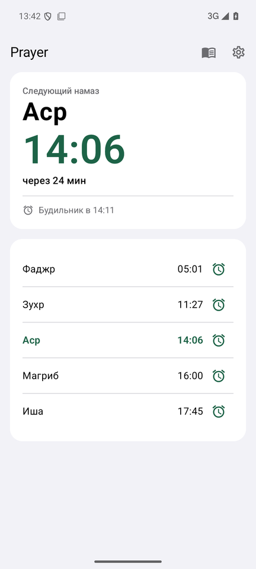
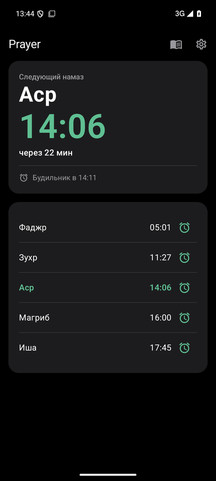
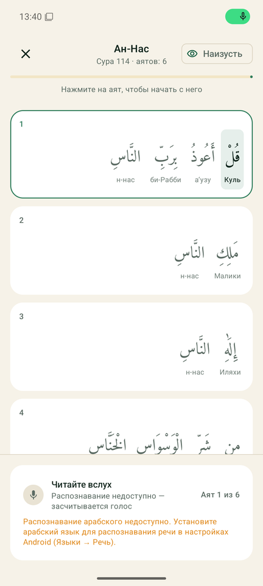
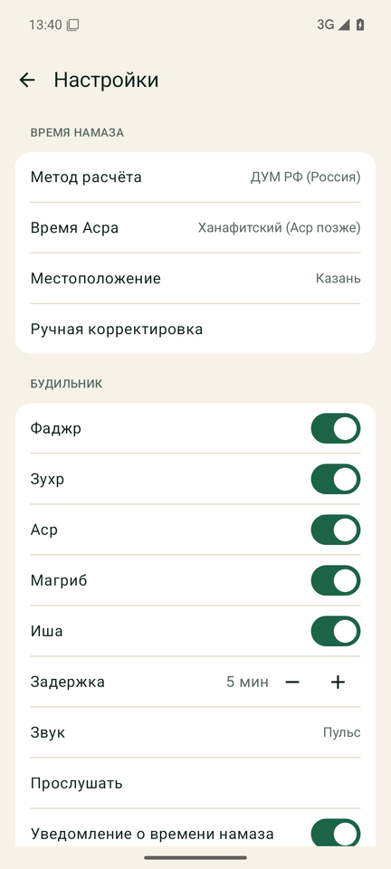
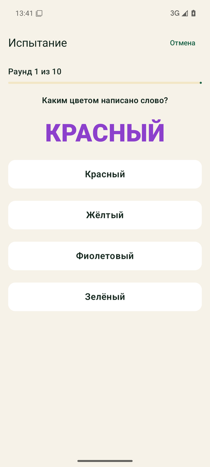

<p align="center">
  
</p>

<p align="center">
  <a href="https://github.com/minchiki/pray-forever/actions/workflows/ci.yml"></a>
  <a href="https://github.com/minchiki/pray-forever/releases/latest"></a>
  
  
  <a href="LICENSE"></a>
  <a href="https://t.me/huicoding"></a>
</p>

**Prayer** считает время пяти намазов по вашему месту и в нужный момент включает громкий будильник. Выключить его можно, только если сфотографировать коврик для намаза или раковину, а потом прочитать вслух короткую суру. Фото распознаётся на самом телефоне, без сети. Речь на iOS распознаёт встроенная модель, на Android — системный распознаватель (на устройстве, если установлен арабский язык). Своего сервера у приложения нет.

Приложение нативное на обеих платформах: Swift и SwiftUI на iOS, Kotlin и Jetpack Compose на Android. Логика, тексты сур, звуки и переводы общие.

<p align="center">
  
  
  
  
  
</p>
<p align="center"><sub>Скриншоты Android-версии с эмулятора.</sub></p>

## Возможности

- **Время намаза** по геолокации или вручную выбранному городу, 13 методов расчёта (ДУМ РФ по умолчанию), ханафитский и шафиитский Аср, ручные поправки для каждого намаза. На широте выше 48° Иша и Фаджр считаются по правилу седьмой части ночи, поэтому летом в России время тоже есть.
- **Настойчивый будильник.** В начале времени приходит уведомление, через выбранную задержку включается сигнал на максимальной громкости. Девять звуков на выбор.
- **Выключение через камеру.** Нужно сфотографировать коврик или раковину живой камерой, галерея недоступна. Тёмный, засвеченный, смазанный кадр и снимок экрана не засчитываются. Можно заранее снять эталонное фото своего коврика.
- **Чтение суры.** После фото нужно прочитать вслух одну из семи коротких сур. Арабский текст с огласовками, транскрипция под каждым словом, слова подсвечиваются по мере чтения. Замолчали на 30 секунд — сигнал возвращается.
- **Защита от обхода.** За час до будильника его нельзя выключить, отложить или сдвинуть время намаза (метод, мазхаб, город) без испытания из 10 раундов. Через 5 минут после задания приходит проверка «не уснул». Аварийное отключение — удержание кнопки 30 секунд, не больше двух раз в неделю.
- **Тренировка** чтения любой суры без будильника, с режимом «наизусть».
- **Пауза** всей системы на срок от часа до недели — тоже через испытание.
- **Виджеты** на iOS (домашний экран и экран блокировки) и на Android.
- Русский и английский интерфейс, светлая и тёмная тема.

## Установка

Готовые сборки лежат в [Releases](https://github.com/minchiki/pray-forever/releases/latest).

**Android 8.0+.** Скачайте APK под свой процессор (почти все телефоны — `arm64-v8a`) и установите, разрешив установку из этого источника. Для Google Play в релизе есть `.aab`.

**iOS 16+.** IPA не подписан. Установите через [Sideloadly](https://sideloadly.io) или AltStore со своим Apple ID (с бесплатным аккаунтом подпись нужно обновлять раз в 7 дней) или подпишите своим сертификатом разработчика.

После первого запуска разрешите уведомления, геолокацию, камеру и микрофон, затем нажмите на главном экране «Проверить будильник» в настройках.

## Как будильник звонит надёжно

| | iOS | Android |
|---|---|---|
| Время звонка | Цепочка локальных уведомлений каждые 30 с (до 60 штук) и AlarmKit на iOS 26+ | `AlarmManager.setAlarmClock` — точно и в режиме Doze |
| Громкость | Тихое фоновое аудио держит приложение живым, сигнал на `.playback` звучит в беззвучном режиме, громкость возвращается на максимум | Foreground-сервис играет на потоке «Будильник» (звучит в беззвучном режиме), громкость возвращается на максимум |
| Экран задания | Открывается при запуске приложения; системный «Стоп» AlarmKit перевзводит будильник через 15 с | Полноэкранное уведомление открывает задание поверх экрана блокировки |
| Приложение выгрузили | Сигнал продолжается уведомлениями и AlarmKit | Сервис живёт отдельно от экрана; после перезагрузки и смены времени расписание восстанавливается |

Если будильник никто не выключил, он звонит час и затихает.

## Распознавание

**Фото.** Сначала проверяется сам кадр: темнота, засвет, пустой кадр, смаз. Затем классификатор на устройстве ищет коврик или раковину: Vision на iOS, ML Kit Image Labeling на Android. Если объект не узнан, фото сравнивается с эталоном: VNFeaturePrint на iOS, эмбеддинг MobileNet V3 (MediaPipe) на Android. Порог сравнения подобран скриптом [`scripts/calibrate_reference_threshold.py`](scripts/calibrate_reference_threshold.py).

**Речь.** На iOS — модель Tarteel `whisper-base-ar-quran` (Apache-2.0) через WhisperKit, запасной вариант — распознаватель Apple. На Android — системный распознаватель речи на арабском, на устройстве, если установлена модель языка. Без распознавания засчитывается звучание голоса, без микрофона слова подсвечиваются сами.

## Сборка

### Android

Нужны JDK 17+ и Android SDK (платформа 36). Одна команда собирает debug APK, release APK по архитектурам и AAB:

```bash
cd android
./gradlew assembleDebug assembleRelease
./gradlew bundleRelease          # AAB для Google Play
```

Результаты — в `android/app/build/outputs/`. Release подписывается ключом из переменных окружения (или файла `.env` в корне), без них собирается неподписанным:

```bash
cp .env.example .env   # и заполните ANDROID_KEYSTORE_PATH, ANDROID_KEYSTORE_PASSWORD, ANDROID_KEY_ALIAS, ANDROID_KEY_PASSWORD
```

Проверки, как в CI:

```bash
./gradlew spotlessCheck lintDebug testDebugUnitTest   # формат, линтер, юнит-тесты
./gradlew spotlessApply                                # отформатировать
./gradlew connectedDebugAndroidTest                    # тесты моделей на устройстве или эмуляторе
```

### iOS

Проект описан в `project.yml` (XcodeGen). На Mac:

```bash
brew install xcodegen swiftlint
bash scripts/fetch_quran_model.sh   # модель Tarteel (~146 МБ), без неё — распознаватель Apple
xcodegen generate
open Sajda.xcodeproj
swiftlint                            # линтер
```

CI на каждом пуше гоняет тесты и собирает неподписанный `Sajda.ipa`.

## Конфигурация

Приложению не нужны ключи и сервер. Переменные из [`.env.example`](.env.example) нужны только для сборки и публикации:

| Переменная | Зачем |
|---|---|
| `ANDROID_KEYSTORE_PATH`, `ANDROID_KEYSTORE_PASSWORD`, `ANDROID_KEY_ALIAS`, `ANDROID_KEY_PASSWORD` | Подпись релизной Android-сборки |
| `TELEGRAM_BOT_TOKEN`, `TELEGRAM_CHAT_ID` | Скрипт анонса `scripts/post_telegram.sh` |

В GitHub Actions подпись берётся из секретов `ANDROID_KEYSTORE_BASE64`, `ANDROID_KEYSTORE_PASSWORD`, `ANDROID_KEY_ALIAS`, `ANDROID_KEY_PASSWORD`.

Версия одна на обе платформы: файл [`VERSION`](VERSION) (Android) и `MARKETING_VERSION` в `project.yml` (iOS).

## Структура

```
Sajda/                 iOS-приложение (Swift, SwiftUI)
  Services/            расчёт времени, планировщик, будильник, AlarmKit
  Recognition/         качество кадра, классификатор, эталонные фото
  Recitation/          суры, нормализация арабского, проверка чтения
  Resources/           звуки, шрифт Amiri Quran, переводы ru/en — общие с Android
SajdaWidget/           виджеты iOS
SajdaTests/            юнит-тесты iOS
android/app/src/main/java/com/prayforever/app/
  core/                чистая логика — порт Swift с теми же тестами
  alarm/               AlarmManager, сервис звонка, уведомления
  recognition/         ML Kit, MediaPipe
  recitation/          распознаватель речи и детектор голоса
  ui/                  экраны на Jetpack Compose
  widget/              виджет (Glance)
design/                генераторы звуков, иконок и баннеров
scripts/               модель Tarteel, тексты сур для Android, калибровка, анонс
assets/                баннеры, логотип, скриншоты
```

## Roadmap

- [ ] Модель Tarteel на Android (сейчас — системный распознаватель речи).
- [ ] Сравнение с эталонным фото на x86_64 (эмуляторы, Chromebook): MediaPipe не поставляет под них нативную библиотеку.
- [ ] Critical Alerts на iOS — код готов, нужен entitlement от Apple.
- [ ] Публикация в App Store и Google Play.
- [ ] Больше сур для чтения и больше языков интерфейса.

## Участие

Баги и идеи — в [Issues](https://github.com/minchiki/pray-forever/issues). Как собрать, проверить и оформить изменения, написано в [CONTRIBUTING.md](CONTRIBUTING.md). Об уязвимостях — по [SECURITY.md](SECURITY.md).

## Лицензия

Код — [MIT](LICENSE). Сторонние ресурсы со своими лицензиями: шрифт Amiri Quran (SIL OFL 1.1), модель Tarteel `whisper-base-ar-quran` (Apache-2.0), MobileNet V3 из MediaPipe (Apache-2.0), библиотека Adhan (MIT).

## Автор

Сделано в канале [HUICODING](https://t.me/huicoding) — там новости проекта и другие разработки.
